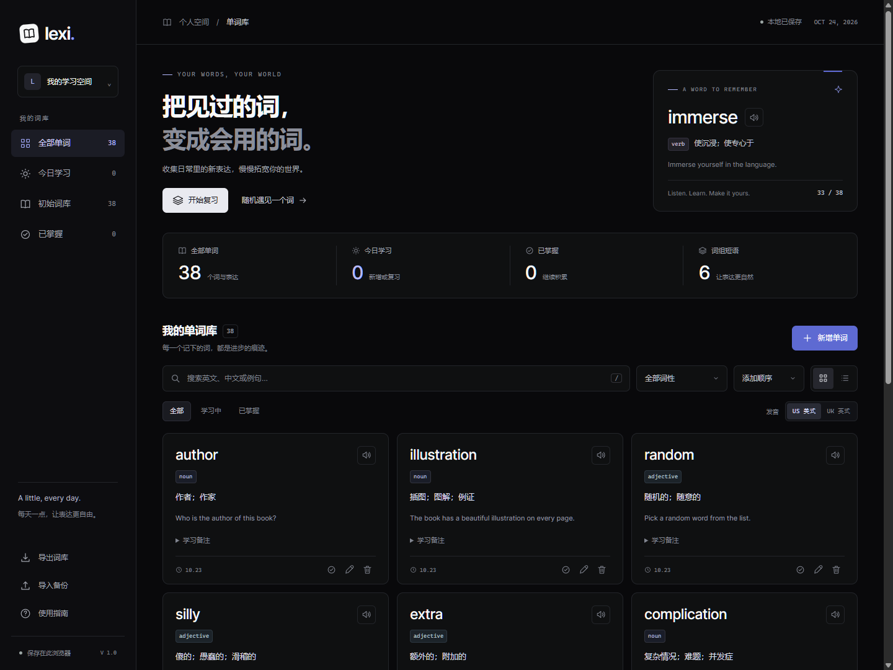

# Lexi · 我的单词库

一个简洁的个人英语单词学习网站，支持词库管理、英美发音、搜索筛选、复习卡片和本地保存。

[在线使用](https://zhangjiayu590-del.github.io/lexi-vocabulary/) · [下载单文件](https://github.com/zhangjiayu590-del/lexi-vocabulary/raw/refs/heads/main/index.html)

也可以下载并双击 `index.html`，使用 Chrome 或 Edge 等现代浏览器打开。无需安装软件、注册账号或运行构建命令。

## 日常使用

1. **新增单词**：点击「新增单词」，填写英文、中文释义、词性，按需添加英文例句和备注，点击保存。学习日期默认为今天，也可以补记之前学过的词。
2. **修改与删除**：每张卡片底部有编辑和删除按钮；删除前需要确认，完成后可在提示中点击「撤销」。圆形对勾可以标记或取消「已掌握」。
3. **发音**：点击英文旁的扬声器。US 为美式 `en-US`，UK 为英式 `en-GB`，默认美式。声音使用浏览器 SpeechSynthesis，优先选择对应口音的本机语音；如果没有，会按语言标签请系统尝试选择，并显示提示。
4. **查找与筛选**：搜索支持英文、中文释义、例句和备注；可以叠加词性和掌握程度筛选。键盘按 `/` 快速进入搜索，也可以按字母或学习时间排序。
5. **复习**：点击「开始复习」，复习当前搜索和筛选结果。先回想，再显示释义；「再练一次」会把该词放到本轮末尾，「记住了」完成这张卡片。复习不会自动改变「已掌握」标记。
6. **备份**：电脑侧边栏「导出词库」下载 JSON 文件；「导入备份」合并已有备份。手机右上角可导出，在「使用指南」中可以导入。相同英文保留当前版本，导入前会显示新增及跳过数量。

## 统计含义

- **全部单词**：当前词库中所有单词和表达的数量。
- **今日学习**：按设备本地日期，统计今天新增或复习过的不同单词。同一个词反复复习只算一次。
- **已掌握**：手动点击卡片对勾标记的单词数。
- **词组短语**：词性选择 `phrase` 的条目数。`zebra crossing` 等复合名词按 `noun` 记录。
- **初始词库**：本次提供的 38 个词，学习日期记为 **2026 年 10 月 23 日**。首次打开时它们不会计入今日新增。

## 数据与运行方式

- 页面、样式、脚本、图标和预置词库全部包含在 `index.html` 中，无外部依赖，可以直接离线打开。语音是否可离线使用由浏览器、系统语音和安装情况决定；如果无声音，请检查音量、英语语音包和网络。
- 数据使用 `localStorage` 自动保存在当前浏览器中，刷新后保留；口音、排序和卡片/列表视图偏好也会保存。
- **请保持同一个浏览器和同一个文件位置。** 不同浏览器、设备、网站地址或文件位置可能使用不同的存储空间。清理网站数据、无痕模式退出等操作可能清除词库，建议定期导出 JSON 备份。
- 如需迁移，在原浏览器中导出，再到新浏览器中导入。可重复导入；相同英文不重复添加。
- 电脑、平板和手机均有响应式布局。手机系统自带的文件预览器可能不执行脚本，请用浏览器打开，或将 `index.html` 放在静态网站服务上访问。
- 不会将你的单词提交到服务器。浏览器或系统语音服务可能自行处理朗读文本。

## 视觉参考

采用 [Awesome-Design-MD 中的 Linear 设计规范](https://github.com/VoltAgent/awesome-design-md/blob/main/design-md/linear.app/DESIGN.md)，并针对个人学习工具改编：近黑画布、炭灰层级、细边框、灰白文字、少量淡紫色强调，8–12px 圆角，以及紧凑的卡片和列表。使用系统字体，不需要下载专有字体或品牌素材。

## 内置词汇

author, illustration, random, silly, extra, complication, precise, unconsciously, trunk, branch, zebra crossing, ideally, promenade, annoying, pause, association, general rule, pavement, scooter, beneath, skyscraper, be scared of, bark at, twilight, dusk, you guys, take action, review, personality, opinion, automatically, require, immerse, sunbed, sunscreen, put on, sunglasses, villa。

每个词都提供中文释义、主要词性、英文例句和学习备注。多义词的其他常见词性或英美差异写在备注中，也可以自行修改。
